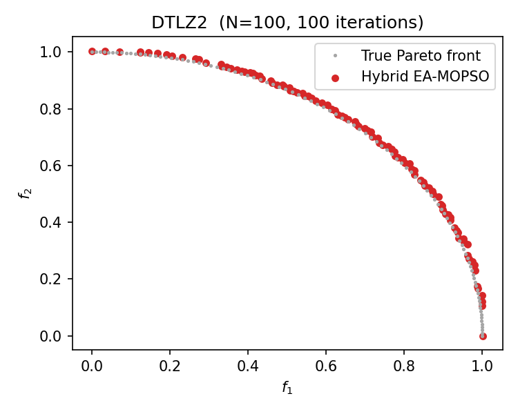
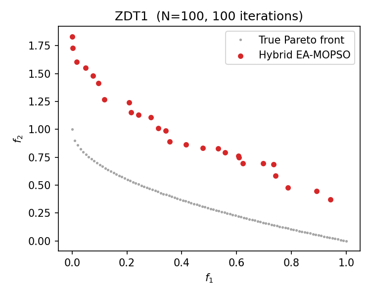

# Hybrid EA-MOPSO

Python implementation of **Hybrid EA-MOPSO**, a multi-objective particle swarm optimiser
enhanced with evolutionary operators, from:

> N. Islam et al., *An Improved Hybrid Multi-Objective Particle Swarm Optimization to Enhance
> Convergence and Diversity*, GECCO '23, Lisbon, Portugal, 2023.

## Algorithm

| Component | Technique |
|---|---|
| Initialisation | Latin Hypercube Sampling, zero velocity |
| Personal best | NSPSO "combine-then-compare": N personal bests + N particles → rank 2N → keep best N (Alg. 1) |
| Ranking | SPEA-II strength Pareto fitness (Alg. 2) |
| External archive | Keeps only non-dominated (strength 0) solutions, truncated by NSGA-II crowding distance (Alg. 3) |
| Global best | Binary tournament on the archive: lower strength fitness wins, ties → larger crowding distance |
| Reproduction | SBX crossover + polynomial mutation (Alg. 4) |

Default parameters follow the paper: `w = 0.5`, `c1 = c2 = 1.5`, crossover `0.7`, mutation `0.7`,
10 particles, 100 iterations.

## Installation

```bash
git clone https://github.com/<your-username>/EA-MOPSO.git
cd EA-MOPSO
pip install -r requirements.txt
```

`ea_mopso.py` itself needs only **NumPy**. `pymoo` (benchmark problems and HV/IGD indicators)
and `matplotlib` (plots) are used by the example script.

## Quick start

Run the benchmarks:

```bash
python run_example.py                              # ZDT1, 1 run
python run_example.py --problem dtlz2 --runs 10    # DTLZ2, 10 independent runs
python run_example.py --problem all --runs 10      # ZDT1, ZDT2, ZDT3, DTLZ2
python run_example.py --problem all --pop 100 --iters 100 --out results/pop100
```

| Option | Default | Meaning |
|---|---|---|
| `--problem` | `zdt1` | `zdt1`, `zdt2`, `zdt3`, `dtlz2`, `all`, or any 2-objective pymoo problem |
| `--pop` | `10` | number of particles |
| `--iters` | `100` | iterations |
| `--archive` | `100` | maximum external archive size |
| `--runs` | `1` | independent runs (mean and std are reported) |
| `--seed` | `1` | base random seed (run *r* uses `seed + r`) |
| `--out` | `results` | output folder |
| `--no-plot` | off | skip the PNG plots |

Each run writes `<problem>_pareto_front.csv`, `<problem>_pareto_front.png` and `summary.txt`
to the output folder.

## Use on your own problem

Write a function that takes an `(n, d)` array of decision vectors and returns an `(n, m)` array
of objective values. **All objectives are minimised**; return the negative of anything you want
to maximise.

```python
import numpy as np
from ea_mopso import EAMOPSO

def my_problem(X):
    f1 = X[:, 0]
    g = 1 + 9 * X[:, 1:].mean(axis=1)
    f2 = g * (1 - np.sqrt(f1 / g))
    return np.c_[f1, f2]

opt = EAMOPSO(my_problem, lb=np.zeros(10), ub=np.ones(10),
              n_particles=10, max_iter=100, seed=1, verbose=True)
pareto_x, pareto_f = opt.run()     # Pareto set and Pareto front from the archive
print(len(pareto_f), "non-dominated solutions")
```

## Sample output

`python run_example.py --problem all --runs 10` (10 particles × 100 iterations = 1,000 evaluations):

```
Problem  n_var    HV mean    HV std   IGD mean   IGD std  time/run
ZDT1        30     0.2537    0.0895     0.4754    0.0824      0.4s
ZDT2        30     0.1070    0.1022     0.5280    0.1615      0.4s
ZDT3        30     0.2893    0.0713     0.5702    0.0990      0.3s
DTLZ2        7     0.8658    0.0250     0.0441    0.0110      0.1s
```

`python run_example.py --problem all --pop 100 --iters 100 --runs 3 --out results/pop100`
(100 particles × 100 iterations = 10,000 evaluations):

```
Problem  n_var    HV mean    HV std   IGD mean   IGD std  time/run
ZDT1        30     0.4575    0.0331     0.3103    0.0242      2.1s
ZDT2        30     0.2240    0.0094     0.3296    0.0099      2.7s
ZDT3        30     0.4470    0.0253     0.3710    0.0238      2.3s
DTLZ2        7     0.9740    0.0028     0.0125    0.0011      1.3s
```

HV is normalised by the hypervolume of the true Pareto front (reference point `[1.1, 1.1]`),
so 1.0 means the true front is fully covered. Lower IGD is better.

| DTLZ2 (100 particles) | ZDT1 (100 particles) |
|---|---|
|  |  |

## Repository layout

```
EA-MOPSO/
├── ea_mopso.py        # the algorithm (NumPy only)
├── run_example.py     # benchmarks with pymoo problems, HV/IGD, plots
├── requirements.txt
└── results/           # sample output
```

## Citation

```bibtex
@inproceedings{islam2023hybridmopso,
  title     = {An Improved Hybrid Multi-Objective Particle Swarm Optimization to Enhance Convergence and Diversity},
  author    = {Islam, N. and others},
  booktitle = {Proceedings of the Genetic and Evolutionary Computation Conference Companion (GECCO '23)},
  year      = {2023},
  doi       = {10.1145/3583133.3596365}
}
```
